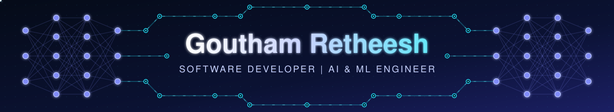
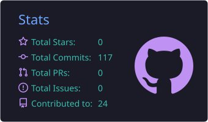
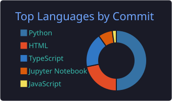
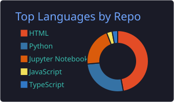
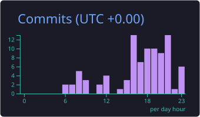

<div align="center">



<a href="https://github.com/Goutham-VR">
  
</a>

<br/>

<a href="mailto:gouthamretheesh143@gmail.com"></a>
<a href="https://github.com/Goutham-VR"></a>
<a href="https://docu-mind-peach-one.vercel.app/"></a>
<a href="https://ai-receptionist-agent-1axs82c9g-gouthams-projects-9b50d089.vercel.app/"></a>

<br/><br/>


</div>

<br/>

## 👋 About Me

```yaml
name: "Goutham Retheesh"
role: "Software Developer | AI & Machine Learning Engineer"
company: "Proggressive Software Solutions"
location: "Ernakulam, Kerala, India 🇮🇳"
education: "M.Sc. Computer Science with Data Analytics — St. Peter's College"
focus: ["RAG & LLM Applications", "Agentic AI", "Computer Vision", "Full-Stack Python (FastAPI / Django)"]
currently_exploring: ["Agentic AI", "RAG Pipelines", "LangChain", "Vector Databases", "LLMs"]
languages_spoken: ["English", "Malayalam"]
fun_fact: "I train models by day and fine-tune prompts by night 🌙"
```

- 🔭 2+ years building **AI-powered web applications** with Python, FastAPI, Django, TensorFlow & PyTorch
- 🧠 Building **RAG systems and agentic LLM workflows** with Gemini, Groq, FastEmbed & pgvector
- ⚙️ Backends with **FastAPI, Django REST Framework & REST APIs**; frontends with **Next.js, React & TypeScript**
- ☁️ Shipping end-to-end — model development to deployment on **Vercel & Render** with **Supabase / PostgreSQL**
- 👁️ Background in **Computer Vision, NLP, Deep Learning & Data Science**
- 📫 Reach me at **gouthamretheesh143@gmail.com**

<br/>

## 🚀 Featured Projects

<table>
<tr>
<td valign="top">

### 📄 DocuMind — AI-Powered PDF Question Answering (RAG)

Full-stack **RAG application**: upload a PDF and ask context-aware questions. Documents are extracted, chunked and embedded with **FastEmbed**, stored in **Supabase pgvector**, and retrieved semantically. **Groq LLM** generates answers grounded in the retrieved content, with **source citations and page references**.

`Python` `FastAPI` `Next.js` `TypeScript` `FastEmbed` `Groq API` `Supabase` `PostgreSQL` `pgvector` `Vercel` `Render`

<a href="https://docu-mind-peach-one.vercel.app/"></a>
<a href="https://github.com/Goutham-VR/DocuMind"></a>

</td>
</tr>
<tr>
<td valign="top">

### 🤖 AI Receptionist Agent — LLM-Powered Agentic AI System

An **agentic workflow** where the LLM interprets user requests, selects the right tools, executes backend operations and answers from **real database results**. Includes appointment availability checking, **execution tracing**, **bounded agent execution** and **human approval workflows**.

`Python` `FastAPI` `React` `Gemini API` `SQLAlchemy` `Supabase` `PostgreSQL` `Vercel` `Render`

<a href="https://ai-receptionist-agent-1axs82c9g-gouthams-projects-9b50d089.vercel.app/"></a>
<a href="https://github.com/Goutham-VR/AI-Receptionist-Agent"></a>

</td>
</tr>
<tr>
<td valign="top">

### 🤟 Sign Language Chat System — Real-Time Gesture Recognition

Real-time communication platform for **hearing-impaired users**, powered by custom ML gesture recognition models. Includes user management, complaint handling, feedback and live chat modules integrated with trained sign interpretation models.

`Python` `Django` `OpenCV` `Machine Learning` `Computer Vision`

<a href="https://github.com/Goutham-VR/SignLanguageChat_Static"></a>

</td>
</tr>
</table>

<br/>

## 💼 Experience

<table>
<tr>
<td width="50%" valign="top">

### 🏢 Software Developer
**Proggressive Software Solutions**
`May 2024 – Present`

- Build and deploy full-stack apps with FastAPI, Django, Python, PHP, HTML, CSS, JavaScript & REST APIs
- Build and train ML, DL, Computer Vision, NLP and LLM solutions with TensorFlow & PyTorch
- Deliver AI projects integrated with REST API backends
- Collaborate cross-functionally to analyze requirements and optimize performance

</td>
<td width="50%" valign="top">

### 📈 Data Science Intern
**Wahy Lab Solutions**
`6-Month Internship`

- Data preprocessing, cleaning & EDA on real-world datasets
- Built and tuned predictive ML and DL models with Scikit-learn, TensorFlow & Keras
- Assisted in training, validation and hyperparameter tuning

</td>
</tr>
</table>

<br/>

## 🧰 Tech Arsenal

### 💻 Languages
<p align="left">


</p>

### 🌐 Frameworks & Web
<p align="left">


</p>

### 🧠 Generative AI & LLM Stack
<p align="left">


</p>

### 🤖 AI / ML / Deep Learning
<p align="left">


</p>

### 📊 Data Science
<p align="left">


</p>

### 🗄️ Databases & Cloud
<p align="left">


</p>

### 🛠️ Dev Tools
<p align="left">


</p>

### 🐧 Systems & Security
<p align="left">


</p>

### 🎨 Creative Tools
<p align="left">


</p>

<br/>

## 🎓 Education

| Degree | Institution | Duration |
|---|---|---|
| M.Sc. Computer Science with Data Analytics | St. Peter's College, Kolenchery, Ernakulam | 2021 – 2023 |
| B.Sc. Electronics & Communication | BPC College, Piravom, Ernakulam | 2018 – 2021 |

<br/>

## 📊 GitHub Analytics

<div align="center">







</div>

<br/>

<!--
🐍 To activate the animated contribution snake below:
1. Go to your repo → Settings → Actions → set "Workflow permissions" to Read & write
2. Add the workflow from https://github.com/Platane/snk to your repo (.github/workflows/snake.yml)
3. It will auto-generate output/github-contribution-grid-snake.svg
-->
<div align="center">

</div>

<br/>

## 🤝 Connect With Me

<div align="center">

<a href="mailto:gouthamretheesh143@gmail.com"></a>
<a href="https://github.com/Goutham-VR"></a>

</div>

<br/>

<div align="center">


<i>⭐ From training neural nets to building agents — always shipping something intelligent.</i>
</div>
